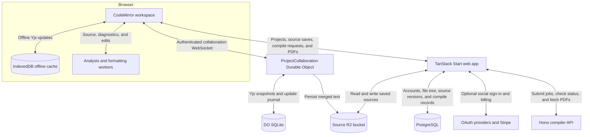

# Texfolia

Texfolia is a browser-based LaTeX workspace. Edit project files, check LaTeX errors, and compile a PDF without leaving the editor.

[Project website](https://www.texfolia.com) · [Local setup](#local-development) · [System design](#system-design) · [Contributing](#contributing)

## Features

- Write LaTeX with syntax highlighting, folding, and completions for project labels, citations, and file paths.
- Format LaTeX with TexFmt and see editor, project, and compiler diagnostics in the Problems panel.
- Preview Markdown and compiled PDFs alongside your source.
- Preview and choose UIW themes across the workspace in Settings → Appearance. See [theme behavior](docs/themes.md).
- Manage user preferences, project formatting, and programmable shortcuts with explicit save controls. See [Settings](docs/settings.md).

## Local development

Texfolia has two environments: local development and production. Local development
uses local Postgres, Docker compiler containers, and Wrangler's local storage and
Durable Object emulation through Vite. Production resources and secrets belong
only in the Cloudflare deployment configuration and production secret store.
Never put production database URLs or secrets in local environment files.

Install [Bun](https://bun.sh) 1.4.4, [Docker](https://www.docker.com) with Compose, and the [Stripe CLI](https://docs.stripe.com/stripe-cli). Start Docker before running the app. Postgres, the Workers runtime, compiler storage, and email delivery run locally. API integrations use your configured credentials.

```sh
git clone https://github.com/natebabyak/texfolia.git
cd texfolia
bun install
cp apps/web/.env.example apps/web/.env
cp packages/db/.env.example packages/db/.env
```

Set `BETTER_AUTH_SECRET` in `apps/web/.env`, for example with a value generated by `openssl rand -base64 32`. Configure a Stripe sandbox `STRIPE_SECRET_KEY` and recurring `STRIPE_PRO_PRICE_ID` and `STRIPE_TEAM_PRICE_ID`, your Turnstile site key and secret, and credentials for the OAuth providers you use. Secrets are required configuration; the app does not generate fallback credentials or replace Stripe with a mock.

Run `bun run --cwd apps/web billing:setup` to create or reuse the $15 Pro and $20/user Team monthly prices, then copy its price IDs into `apps/web/.env`. See [subscription billing setup and verification](docs/billing.md) for shared billing, portal configuration, and sandbox checks.

Set `DATABASE_URL` in `packages/db/.env` to your local database. Keep `DATABASE_URL` and `CLOUDFLARE_HYPERDRIVE_LOCAL_CONNECTION_STRING_HYPERDRIVE` in `apps/web/.env` pointed at the same database. The example values match the Compose Postgres credentials and use `db` on `localhost:5432`.

Local database, compiler, and engine URLs must use `localhost`, `127.0.0.1`, or
`[::1]`. Startup rejects cloud URLs and `CLOUDFLARE_ENV` overrides. Vite disables
remote bindings. `db:push` and `auth:schema` also require a local database.
Keep local integration credentials separate from production credentials.

### Forward Stripe webhooks

Log the Stripe CLI into the same sandbox as the app's Stripe API key. In a separate terminal, run:

```sh
stripe login
stripe listen --forward-to localhost:3000/api/auth/stripe/webhook
```

The listener forwards events to `localhost:3000/api/auth/stripe/webhook`. Copy its signing secret into `STRIPE_WEBHOOK_SECRET` in `apps/web/.env`, then start or restart the app. Keep the listener running while testing subscriptions. Use the listener's signing secret for local forwarding, rather than a dashboard webhook endpoint's secret. This follows [Better Auth's local webhook setup](https://better-auth.com/docs/plugins/stripe#testing-webhooks-locally).

### Start the app

Before the first run, start Postgres and apply the local schema:

```sh
bun run db:start
bun run db:push
```

Run `bun run db:push` again after changing the schema. To add the original
templates to Postgres and local R2, run `bun run db:seed` after applying the schema.
Schema changes and seeds are explicit operations. `bun run dev` runs neither.

Start both apps:

```sh
bun run dev
```

Turbo starts Postgres, waits for its health check, and starts the web app at
[localhost:3000](http://localhost:3000). It also builds the LaTeX engine image
and runs the Hono compiler locally with Bun's file watcher. The compiler starts
a dedicated Docker engine container when a project first compiles. The first
image build downloads and caches the base LaTeX packages. Additional packages
may need a network connection when first used.

Press Ctrl+C to stop the development processes. Postgres and project engine
containers keep running. Run `docker compose stop` to stop Postgres. Database
data persists in the Compose volume, and compiler data persists in
`apps/compiler/.cache/compiler.sqlite`.

Development and build commands delegate to Turbo. To run one app independently:

```sh
bun run dev:web
bun run dev:compiler
```

Run these in separate terminals when you need both apps. `dev:web` starts
Postgres and the web app. `dev:compiler` builds the engine image and starts only
the compiler API at `http://localhost:8080`. The equivalent Turbo filters are
`bunx turbo run dev --filter=web` and `bunx turbo run dev --filter=compiler`.
For template previews and other legacy snapshot jobs, follow the
[compiler's local engine setup](apps/compiler/README.md#run-locally).

Cloudflare simulates the email binding locally and logs the file containing
each sign-in code or invitation. You can also inspect sent messages in
[Local Explorer](http://localhost:3000/cdn-cgi/local/explorer). Auth uses the same
plugins and login flow in every environment, including Stripe customer setup
and webhook signature verification.

The web app reads `env.HYPERDRIVE.connectionString` in both environments. Local
development uses `CLOUDFLARE_HYPERDRIVE_LOCAL_CONNECTION_STRING_HYPERDRIVE` from
`apps/web/.env`. Compiler requests use loopback HTTP locally and a service
binding on Cloudflare. The local compiler stores jobs and PDFs in its SQLite
database.

See the [database guide](packages/db/README.md) for standalone schema operations
and integration checks. For deployed environments, follow
[Set up Neon and Hyperdrive](docs/database-deployment.md).

### Compile your first PDF

1. Open [localhost:3000](http://localhost:3000) and sign in.
2. Create a project and paste the example below into `main.tex`.
3. Press Cmd/Ctrl+S or select **File → Save & compile**. The PDF Preview panel shows the result.

```latex
\documentclass{article}
\begin{document}
Hello from Texfolia!
\end{document}
```

## System design

### Where editing and storage happen



Text edits merge through Yjs and persist in the collaboration object before broadcast. An alarm writes merged text to R2, and IndexedDB retains offline updates. PostgreSQL stores the file tree, saved source versions, and job records.

**Save** (Cmd/Ctrl+S) compiles after saving by default; turn off **Compile after saving** in Settings → Editor to save only. **Save without compiling** (Cmd/Ctrl+K S) never compiles. **Save & compile** (Cmd/Ctrl+Shift+B) saves first, then submits a revisioned source delta to the compiler coordinator. Binary files use their saved content hashes. Typing marks the preview stale. See the [source storage and collaboration reference](apps/web/README.md#project-source-storage).

Browser workers check references as you edit and format LaTeX on request.

Compile stage boundaries and the p50/p95 query are documented in
[Compile telemetry](docs/compile-telemetry.md).

### How a compile becomes a PDF


On Cloudflare, the web app calls the private compiler through a service binding.
One SQLite-backed Durable Object coordinates each project and persists its
container assignment from PoolManager. Each assigned container serves only that
project. Locally, Bun runs the same coordinator logic with SQLite and creates
dedicated Docker containers. Both runtimes use the
same Go engine image. R2 stores production artifacts; SQLite stores them locally.
Queues handle infrastructure retries, legacy jobs, and background maintenance.
See the [compiler guide](apps/compiler/README.md) for the shared contract test.

## Repository layout

| Path                                                       | Responsibility                                                                                                |
| ---------------------------------------------------------- | ------------------------------------------------------------------------------------------------------------- |
| [`apps/web`](apps/web)                                     | React workspace, Better Auth, project management, and the browser-facing compile endpoint.                    |
| [`apps/compiler`](apps/compiler)                           | Hono API, job processing, and Tectonic. See the [compiler API and deployment guide](apps/compiler/README.md). |
| [`packages/db`](packages/db)                               | Drizzle schema, PostgreSQL client, and database migrations.                                                   |
| [`packages/typescript-config`](packages/typescript-config) | Shared TypeScript settings.                                                                                   |

## Contributing

Open an issue for a bug or feature request. For editor or compiler bugs, include the steps to reproduce the issue and a small source sample. Install Go 1.26 or later for the engine checks. Run these checks before opening a pull request.

```sh
bun run lint
bun run format:check
bun run typecheck
bun run test
```

These commands include the Bun tests, Go race tests, Go vet, TypeScript
checks, Oxlint, and formatting checks. Run `bun run format` to apply Oxfmt and
Gofmt. Oxlint and Oxfmt use the root `.oxlintrc.json` and `.oxfmtrc.json`
configurations. `bun run build` builds the web app and LaTeX engine image.

`bun run lint` also checks local Markdown links and Tailwind-only styles.
Run `bun run check:repo` separately while editing.

Run `bun run lint:fix` to apply automatic Oxlint fixes.

`bun run db:push`, `bun run auth:schema`, `bun run cf:typegen`, and
`bun run deploy` also run through Turbo. Deploy explicitly selects `production`
for both Workers, builds the web app, and deploys the compiler before the web
Worker. Before the first deploy, complete the
[database deployment setup](docs/database-deployment.md), including committed
migrations and explicit environment targeting.
The web build script selects `env.production` before Vite generates its deploy
configuration. Both Workers' default Wrangler configurations use isolated local
resource names. Existing production resource placeholders
must be configured before deployment.

## Projects

The authenticated `/projects` dashboard combines blank/template creation, Git import,
and files/folder uploads in one dialog. It includes private tags and a sortable,
client-filtered table. See [Projects dashboard](docs/projects.md) for details.

## Templates

Browse `/templates`, publish a saved project at `/templates/publish`, and open an
independent personal or organization copy from `/template/{templateId}`. Published
snapshots are reviewed, and unlisted templates stay out of the public gallery.
See [the templates setup and verification guide](docs/templates.md)
for database rollout, compiler previews, reviewer configuration, and starter seeds.

## License

Texfolia is licensed under the [GNU General Public License v3.0](LICENSE).
