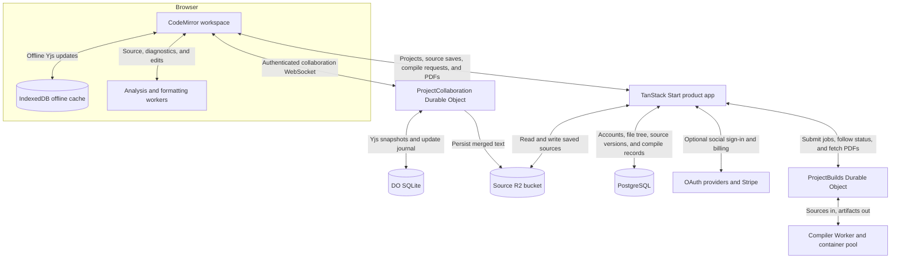
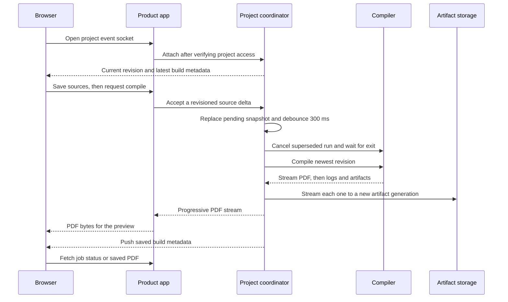

# Texfolia

A browser-based LaTeX workspace. Edit project files, check LaTeX errors, and compile a PDF without leaving the editor.

[Website](https://www.texfolia.com) · [Quick start](#quick-start) · [System design](#system-design) · [Repository layout](#repository-layout)

> [!WARNING]
> Texfolia is pre-release. Features, APIs, and data formats may change without notice.

## Features

- LaTeX editing with syntax highlighting, folding, and completions for labels, citations, and file paths
- Real-time collaboration, review comments, and read-only share links
- Git commits, pushes, and pulls with a linked GitHub or GitLab repository
- An AI assistant that edits project files, with changes to review and revert
- Spell check in each project's language, with a personal dictionary
- TexFmt formatting and a Problems panel for editor, project, and compiler diagnostics
- Side-by-side Markdown and PDF preview
- Workspace themes, settings, and programmable shortcuts
- Projects from a blank file, a Git repository, or uploaded files and folders

## Quick start

Requires [Bun](https://bun.sh) 1.4.4, [Docker](https://www.docker.com) with Compose, and the [Stripe CLI](https://docs.stripe.com/stripe-cli).

```sh
git clone https://github.com/texfolia/texfolia.git
cd texfolia
bun install
bun run setup   # create .env files, start Postgres, apply the schema
bun run dev     # start every app
```

Fill in the Stripe and Turnstile values in `apps/web/.env` before you sign in.
Then create a project and press Cmd/Ctrl+S to save and compile.

| App                                  | Run on its own         | URL                                     |
| ------------------------------------ | ---------------------- | --------------------------------------- |
| [Web app](apps/web/README.md)        | `bun run dev:web`      | [localhost:3000](http://localhost:3000) |
| [Documentation](apps/docs/README.md) | `bun run dev:docs`     | [localhost:4322](http://localhost:4322) |
| [Compiler](apps/compiler/README.md)  | `bun run dev:compiler` | `http://localhost:8080`                 |

Other root commands: `build`, `test`, `typecheck`, `lint`, `format`,
`db:start`, `db:stop`, and `db:push`. Each delegates to the
workspace that owns it. Secrets, Stripe webhooks and the rest are covered in the
[local development guide](apps/docs/content/docs/local-development.md).

## System design

- **Browser:** a CodeMirror workspace, with workers for analysis, formatting, and spelling and an IndexedDB offline cache. The LaTeX language tooling, spelling, and editor themes live in `#/lib/editor` (feature code is under `apps/web/src/lib`); the shadcn primitives live in `#/components/ui`; R2 source objects (keys, uploads, limits, garbage collection) live in `#/lib/storage`; the project aggregate (CRUD, file-tree nodes, paths, metadata, search, and owner/organization access) lives in `#/lib/projects`; the app's compile client (source deltas, the `/api/compile` handlers, build events, logs, and history) lives in `#/lib/compile`; Yjs collaboration (the room, protocol, browser cache, and drafts) lives in `#/lib/collaboration`; Git integrations (actions against a linked GitHub or GitLab remote, remote URL parsing, and the platform adapters) live in `#/lib/git`; Stripe billing (plans, checkout, the portal and webhooks, entitlements, and AI usage metering) lives in `#/lib/billing`; the AI assistant (chat runs, project tools, saved threads, skills, and the panel UI) lives in `#/lib/ai`.
- **Collaboration:** edits merge through Yjs in a Durable Object per project, then persist to R2.
- **Web app:** TanStack Start on Cloudflare Workers (`texfolia.com`). Serves the landing, pricing, and policy pages alongside the authenticated workspace. PostgreSQL holds accounts, the file tree, and build records.
- **Compiler:** an Effect Worker in front of an autoscaled pool of Tectonic containers that projects share. A container keeps one caller's sources and cache between compiles and wipes them before it serves another. The PDF streams back to the preview.

### Where editing and storage happen



### How a compile becomes a PDF



More detail: [web app architecture](apps/web/ARCHITECTURE.md), [project builds](apps/web/src/lib/builds/README.md), and the [compiler](apps/compiler/README.md).

## Repository layout

```text
apps/
  compiler/            Compile service: Effect Worker, autoscaler, and the Go LaTeX engine
  docs/                Astro + Starlight documentation site
  web/                 TanStack Start app: landing, pricing, policies, auth, projects, and the compile endpoint
    src/lib/           App features: ai, auth, billing, builds, collaboration, comments,
                       compile, editor, email, git, projects, references, settings,
                       sharing, shortcuts, storage, theme, workspace
packages/
  contracts/           Schemas and plan prices shared by the apps
  db/                  Drizzle schema, PostgreSQL client, and migrations
  tsconfig/            TypeScript settings every workspace extends
```

## Contributing

Texfolia is still in development and isn't accepting contributions yet. See
[CONTRIBUTING.md](.github/CONTRIBUTING.md), [SECURITY.md](.github/SECURITY.md) to report a
vulnerability, and [ACKNOWLEDGEMENTS.md](ACKNOWLEDGEMENTS.md) for the projects Texfolia builds on.

## License

Texfolia is licensed under the [GNU General Public License v3.0](LICENSE).
