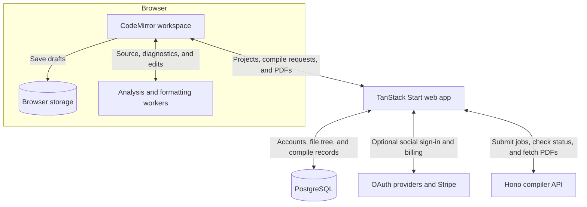
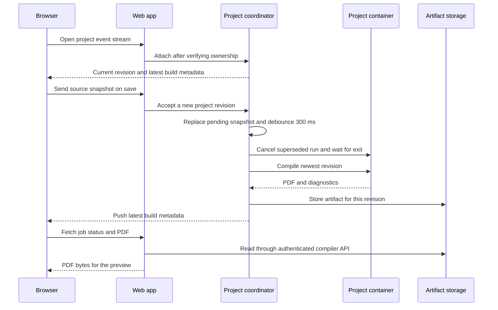

# Texfolia

Texfolia is a browser-based LaTeX workspace. Edit project files, check LaTeX errors, and compile a PDF without leaving the editor.

[Project website](https://www.texfolia.com) · [Local setup](#local-development) · [System design](#system-design) · [Contributing](#contributing)

## Features

- Write LaTeX with syntax highlighting, folding, and completions for project labels, citations, and file paths.
- Format LaTeX with TexFmt and see editor, project, and compiler diagnostics in the Problems panel.
- Preview Markdown and compiled PDFs alongside your source.
- Apply app-wide themes or import a VS Code color theme in Settings → Appearance. See [theme behavior and import limits](docs/themes.md).

## Local development

Install [Bun](https://bun.sh) 1.4.4, [Docker](https://www.docker.com) with Compose, and the [Stripe CLI](https://docs.stripe.com/stripe-cli). Start Docker before running the app. Postgres, the Workers runtime, compiler storage, and email delivery run locally. API integrations use your configured credentials.

```sh
git clone https://github.com/natebabyak/texfolia.git
cd texfolia
bun install
cp apps/web/.env.example apps/web/.env
cp packages/db/.env.example packages/db/.env
```

Set `BETTER_AUTH_SECRET` in `apps/web/.env`, for example with a value generated by `openssl rand -base64 32`. Configure a Stripe sandbox `STRIPE_SECRET_KEY` and recurring `STRIPE_PRO_PRICE_ID`, your Turnstile site key and secret, and credentials for the OAuth providers you use. Secrets are required configuration; the app does not generate fallback credentials or replace Stripe with a mock.

Set `DATABASE_URL` in `packages/db/.env` to your local database. Keep `DATABASE_URL` and `CLOUDFLARE_HYPERDRIVE_LOCAL_CONNECTION_STRING_HYPERDRIVE` in `apps/web/.env` pointed at the same database. The example values match the Compose Postgres credentials and use `db` on `localhost:5432`.

### Forward Stripe webhooks

Log the Stripe CLI into the same sandbox as the app's Stripe API key. In a separate terminal, run:

```sh
stripe login
bun run stripe:listen
```

The listener forwards events to `localhost:3000/api/auth/stripe/webhook`. Copy its signing secret into `STRIPE_WEBHOOK_SECRET` in `apps/web/.env`, then start or restart the app. Keep the listener running while testing subscriptions. Use the listener's signing secret for local forwarding, rather than a dashboard webhook endpoint's secret. This follows [Better Auth's local webhook setup](https://better-auth.com/docs/plugins/stripe#testing-webhooks-locally).

### Start the app

```sh
bun run dev
```

Turbo builds the compiler images, starts Postgres and the compiler, waits for
service health, applies the database schema, and starts the web app at
[localhost:3000](http://localhost:3000). The compiler reloads when its source
changes. The first run downloads container images and caches the compiler's
base LaTeX packages. Additional packages may need a network connection when
first used.

To run the compiler in the local Workers runtime instead:

```sh
bun run dev:workers
```

This starts Postgres, the compiler Worker at `http://localhost:8787`, and the web
app configured to use it. Both modes use Docker for project engines. Stop the
current mode before switching. Press Ctrl+C to stop the development processes;
`bun run dev:stop` stops the Compose services that remain running. Database and
compiler volumes persist between runs.

Development, build, and verification commands delegate to Turbo. Filtering the
web task also starts its compiler companion and setup dependencies:

```sh
bunx turbo run dev --filter=web
```

Cloudflare simulates the email binding locally and logs the file containing
each sign-in code or invitation. You can also inspect sent messages in
[Local Explorer](http://localhost:3000/cdn-cgi/local/explorer). Auth uses the same
plugins and login flow in every environment, including Stripe customer setup
and webhook signature verification.

The web app reads `env.HYPERDRIVE.connectionString` in both environments. Local
development uses `CLOUDFLARE_HYPERDRIVE_LOCAL_CONNECTION_STRING_HYPERDRIVE` from
`apps/web/.env`. Compiler requests use loopback HTTP locally and a service
binding on Cloudflare. The local compiler stores jobs and PDFs in its SQLite
volume.

See the [database guide](packages/db/README.md) for standalone schema operations
and integration checks. For deployed environments, follow
[Set up Neon and Hyperdrive](docs/database-deployment.md).

### Compile your first PDF

1. Open [localhost:3000](http://localhost:3000) and sign in.
2. Create a project and paste the example below into `main.tex`.
3. Select **Save & compile**. The PDF Preview panel shows the result.

```latex
\documentclass{article}
\begin{document}
Hello from Texfolia!
\end{document}
```

## System design

### Where editing and storage happen



**Save & compile**, or Cmd/Ctrl+S, saves text drafts in the current browser and sends a snapshot to the project coordinator. Typing marks the preview stale. Compilation runs on save. PostgreSQL stores the file tree and job records.

Browser workers check references as you edit and format LaTeX on request.

Compile stage boundaries and the p50/p95 query are documented in
[Compile telemetry](docs/compile-telemetry.md).

### How a compile becomes a PDF



On Cloudflare, the web app calls the private compiler through a service binding.
One SQLite-backed Durable Object coordinates each project and routes to a
container that serves only that project. Locally, Bun runs the same coordinator
logic with SQLite and creates dedicated Docker containers. Both runtimes use the
same Go engine image. R2 stores production artifacts; SQLite stores them locally.
Queues handle infrastructure retries and legacy jobs. See the
[compiler guide](apps/compiler/README.md) for the shared contract test.

## Repository layout

| Path                                                       | Responsibility                                                                                                |
| ---------------------------------------------------------- | ------------------------------------------------------------------------------------------------------------- |
| [`apps/web`](apps/web)                                     | React workspace, Better Auth, project management, and the browser-facing compile endpoint.                    |
| [`apps/compiler`](apps/compiler)                           | Hono API, job processing, and Tectonic. See the [compiler API and deployment guide](apps/compiler/README.md). |
| [`packages/db`](packages/db)                               | Drizzle schema, PostgreSQL client, and database migrations.                                                   |
| [`packages/typescript-config`](packages/typescript-config) | Shared TypeScript settings.                                                                                   |

## Contributing

Open an issue for a bug or feature request. For editor or compiler bugs, include the steps to reproduce the issue and a small source sample. Install Go 1.26 or later for the engine checks. Run these checks before opening a pull request.

```sh
bun run lint
bun run format:check
bun run typecheck
bun run test
```

These Turbo tasks include the Bun tests, Go race tests, Go vet, TypeScript
checks, Oxlint, and formatting checks. Run `bun run format` to apply Oxfmt and
Gofmt. Oxlint and Oxfmt use the root `.oxlintrc.json` and `.oxfmtrc.json`
configurations. `bun run build` builds the web app and compiler images.

With either development mode running, verify actual compilation through Turbo:

```sh
bun run smoke          # Local Bun compiler
bun run smoke:workers  # Local Workers compiler
```

`bun run db:push`, `bun run auth:schema`, `bun run cf:typegen`, and
`bun run deploy` also run through Turbo. Deploy builds the web app and deploys
the compiler before the web Worker.

## License

Texfolia is licensed under the [GNU General Public License v3.0](LICENSE).
