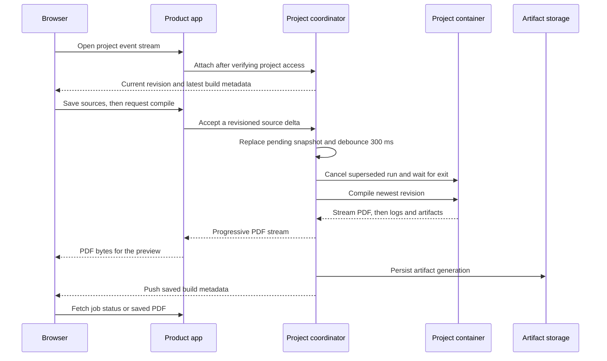

# Texfolia

A browser-based LaTeX workspace. Edit project files, check LaTeX errors, and compile a PDF without leaving the editor.

[Website](https://www.texfolia.com) · [Quick start](#quick-start) · [System design](#system-design) · [Repository layout](#repository-layout)

> [!WARNING]
> Texfolia is pre-release. Features, APIs, and data formats may change without notice.

## Features

- LaTeX editing with syntax highlighting, folding, and completions for labels, citations, and file paths
- Spell check in each project's language, with a personal dictionary
- TexFmt formatting and a Problems panel for editor, project, and compiler diagnostics
- Side-by-side Markdown and PDF preview
- Workspace themes, settings, and programmable shortcuts
- Projects from a blank file, a template, or uploaded files and folders
- A template gallery, with publishing for your own projects

## Quick start

Requires [Bun](https://bun.sh) 1.4.4, [Docker](https://www.docker.com) with Compose, and the [Stripe CLI](https://docs.stripe.com/stripe-cli).

```sh
git clone https://github.com/natebabyak/texfolia.git
cd texfolia
bun install
cp apps/app/.env.example apps/app/.env
cp apps/web/.env.example apps/web/.env
cp packages/db/.env.example packages/db/.env
# Fill in the secrets in apps/app/.env, then:
bun run db:start
bun run db:push
bun run dev
```

Open the product app at [localhost:3000](http://localhost:3000) and the marketing
site at [localhost:4321](http://localhost:4321). Create a project and press
Cmd/Ctrl+S to save and compile.

Secrets, Stripe webhooks, and running each app on its own are covered in the [local development guide](docs/local-development.md).

## System design

- **Browser:** a CodeMirror workspace, with workers for analysis, formatting, and spelling and an IndexedDB offline cache. The LaTeX language tooling, spelling, and editor themes live in `@texfolia/editor`; the shadcn primitives live in `@texfolia/ui`; R2 source objects (keys, uploads, limits, garbage collection) live in `@texfolia/storage`.
- **Collaboration:** edits merge through Yjs in a Durable Object per project, then persist to R2.
- **Product app:** TanStack Start on Cloudflare Workers (`app.texfolia.com`). PostgreSQL holds accounts, the file tree, and build records.
- **Marketing site:** TanStack Start + React on Cloudflare Workers (`texfolia.com`). Static pages are prerendered; the templates gallery reads the app's public catalog API.
- **Compiler:** a Hono API. Each project gets its own LaTeX engine container, and the PDF streams back to the preview.

### Where editing and storage happen


### How a compile becomes a PDF



More detail: [product app](apps/app/README.md), [marketing site](apps/web/README.md), [compiler](apps/compiler/README.md), and the [docs](docs) folder.

## Repository layout

```text
apps/
  app/                 React product app: auth, projects, and the compile endpoint
  compiler/            Hono compiler API, job processing, and the LaTeX engine
  web/                 React marketing site: landing, pricing, policies, templates gallery
packages/
  auth/                Shared Better Auth server and client helpers
  config/              Shared TypeScript settings
  contracts/           Schemas shared by the product app and the compiler
  db/                  Drizzle schema, PostgreSQL client, and migrations
  editor/              LaTeX language tooling, spelling, and CodeMirror themes for the app
  ui/                  shadcn/Base UI React primitives for the app
docs/                  Feature and operations guides
```

## Contributing

Texfolia is still in development and isn't accepting contributions yet.

## License

Texfolia is licensed under the [GNU General Public License v3.0](LICENSE).
