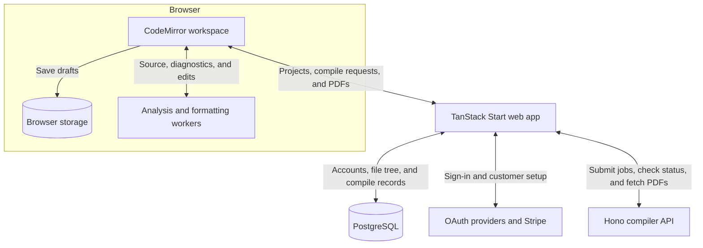
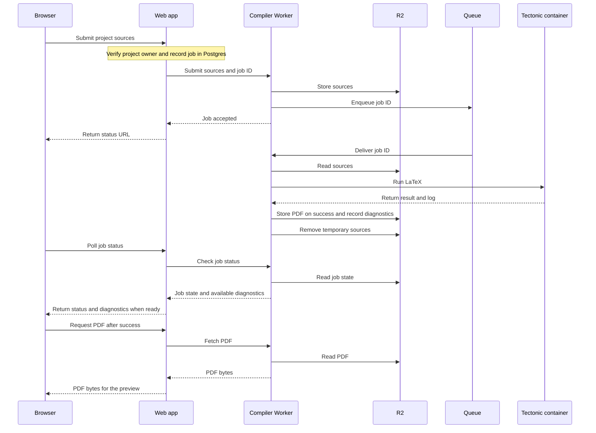

# Texfolia

Texfolia is a browser-based LaTeX workspace. Edit project files, check LaTeX errors, and compile a PDF without leaving the editor.

[Project website](https://www.texfolia.com) · [Local setup](#local-development) · [System design](#system-design) · [Contributing](#contributing)

## Features

- Write LaTeX with syntax highlighting, folding, and completions for project labels, citations, and file paths.
- Format LaTeX with TexFmt and see editor, project, and compiler diagnostics in the Problems panel.
- Preview Markdown and compiled PDFs alongside your source.
- Apply app-wide themes or import a VS Code color theme in Settings → Appearance. See [theme behavior and import limits](docs/themes.md).

## Local development

Install [Bun](https://bun.sh) 1.4.4 and [Docker](https://www.docker.com) with Compose. To sign in locally, you'll also need OAuth credentials for one provider and a Stripe test secret key.

### Install and configure

```sh
git clone https://github.com/natebabyak/texfolia.git
cd texfolia
bun install
cp apps/web/.env.example apps/web/.env
cp packages/db/.env.example packages/db/.env
```

Set these values in `apps/web/.env`.

| Variable                                   | Local value                                                                                                                                                                    |
| ------------------------------------------ | ------------------------------------------------------------------------------------------------------------------------------------------------------------------------------ |
| `BETTER_AUTH_SECRET`                       | Generate a secret with `openssl rand -base64 32`.                                                                                                                              |
| `GITHUB_CLIENT_ID`, `GITHUB_CLIENT_SECRET` | Use a GitHub OAuth app with the callback `http://localhost:3000/api/auth/callback/github`. See the [GitHub sign-in guide](https://better-auth.com/docs/authentication/github). |
| `STRIPE_SECRET_KEY`                        | Use a Stripe test secret key. The app initializes Stripe at startup and creates a customer on first sign-in.                                                                   |

The example files already point to the local web app, database, and compiler. If you change `DATABASE_URL`, update both environment files. The local compiler accepts requests without a token by default.

### Start the stack

```sh
docker compose up -d --build db compiler
bun run --cwd packages/db push
bun run --cwd apps/web dev
```

Run the schema command once Postgres is ready. For an existing database, see the [database upgrade instructions](packages/db/README.md#existing-object-sizes).

### Compile your first PDF

1. Open [localhost:3000](http://localhost:3000) and sign in.
2. Create a project and paste the example below into `main.tex`.
3. Select **Save & compile**. The PDF Preview panel shows the result.

```latex
\documentclass{article}
\begin{document}
Hello from Texfolia!
\end{document}
```

## System design

### Where editing and storage happen



**Save & compile** saves text drafts in the current browser and sends a copy to the compiler. PostgreSQL stores the file tree and job records.

Browser workers check references as you edit and format LaTeX on request.

Compile stage boundaries and the p50/p95 query are documented in
[Compile telemetry](docs/compile-telemetry.md).

### How a compile becomes a PDF



On Cloudflare, the web app calls the compiler through a private service binding.
The compiler Worker uses R2 for job data and PDFs, and Cloudflare Queues to
dispatch jobs. Locally, the same Hono API uses loopback HTTP with SQLite. Both
runtimes call a separate Go engine image that runs Tectonic and returns the PDF
and diagnostics. Neither connection requires an internal token.

## Repository layout

| Path                                                       | Responsibility                                                                                                |
| ---------------------------------------------------------- | ------------------------------------------------------------------------------------------------------------- |
| [`apps/web`](apps/web)                                     | React workspace, Better Auth, project management, and the browser-facing compile endpoint.                    |
| [`apps/compiler`](apps/compiler)                           | Hono API, job processing, and Tectonic. See the [compiler API and deployment guide](apps/compiler/README.md). |
| [`packages/db`](packages/db)                               | Drizzle schema, PostgreSQL client, and database migrations.                                                   |
| [`packages/typescript-config`](packages/typescript-config) | Shared TypeScript settings.                                                                                   |

## Contributing

Open an issue for a bug or feature request. For editor or compiler bugs, include the steps to reproduce the issue and a small source sample. Run these checks before opening a pull request.

```sh
bun run lint
bun run format:check
bun run typecheck
bun run test
```

Run `bun run format` to apply Oxfmt formatting. Oxlint and Oxfmt use the root
`.oxlintrc.json` and `.oxfmtrc.json` configurations.

## License

Texfolia is licensed under the [GNU General Public License v3.0](LICENSE).
